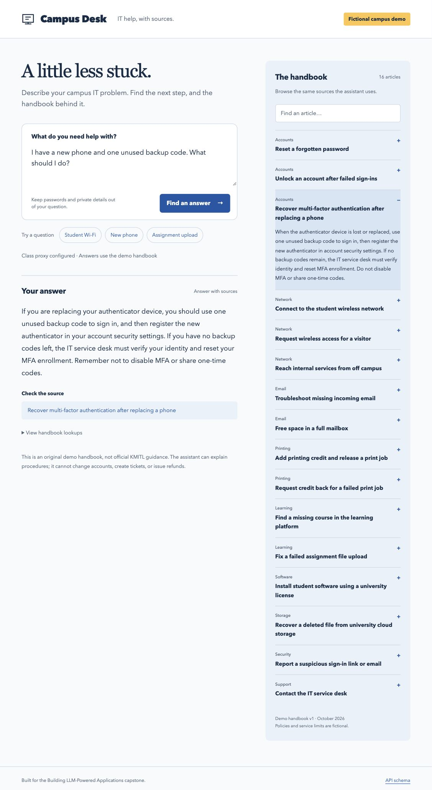
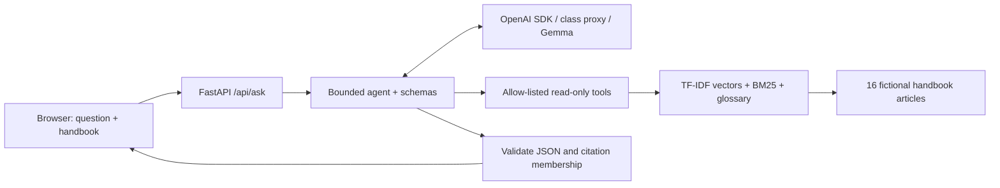

# Campus Desk

A grounded university IT helpdesk assistant for students who need a next step, with the handbook article beside the answer.

**This is a fictional campus demo, not official KMITL guidance.** Its original 16-article handbook covers accounts, MFA recovery, wireless access, VPN, email, printing, assignment uploads, software, cloud storage, and phishing. It contains no student records or real institutional policies. The app explains procedures; it cannot reset accounts, issue refunds, create tickets, or change university records.

**Q3 live app:** [Open Campus Desk](https://campus-desk-llm.onrender.com/). Hosted on Render Free; the first visit after inactivity may take about a minute to wake the service. Public model requests have a shared workload budget. Try the new-phone question and inspect its source; the known injection request can produce a safe validation error instead of a useful answer.

Built for Q1 of the [Building LLM-Powered Applications capstone](https://courses.nat-d.uk/courses/building-llm-powered-applications/courseworks/20). This implementation, corpus, glossary, and evaluation were authored with AI assistance. The course permits AI tools; the student still needs to understand and defend the design and results. The instructor's [reference application](https://github.com/Nat-D/kmitl-llm-app-demo) is educational context, not the code or corpus submitted here.



## Run from a fresh clone

Tested on Python 3.13.13. No Node.js, embedding download, database server, or paid external search service is needed.

```bash
git clone https://github.com/vpalee/campus-desk-llm.git
cd campus-desk-llm
python3 -m venv .venv
source .venv/bin/activate
python -m pip install -r requirements.lock
cp .env.example .env
```

Edit `.env` and replace the placeholder key with **your own class-proxy key** from the course sandbox. Keep the HTTPS class proxy URL from your course setup; the example uses `https://llm.nat-d.uk/v1`. The app intentionally accepts only the `llm.nat-d.uk` proxy host. Existing shell environment variables take precedence over `.env`.

```dotenv
OPENAI_API_KEY=your-own-class-proxy-key
OPENAI_BASE_URL=https://llm.nat-d.uk/v1
```

Then:

```bash
python -m uvicorn app.main:app --host 127.0.0.1 --port 8765
```

Open **http://127.0.0.1:8765**. Try **New phone**, submit the question, then select its source to open the article. The browser and handbook still load without a key; model requests require working course credentials. Configuration status means environment validation passed, not that the remote service is reachable.

To run again after setup, use `./run.sh`. On Windows, use the Python command above. Dependencies are pinned in `requirements.lock`; `requirements.txt` lists direct dependencies.

## Course capability coverage

| Family | Implementation / evidence |
|---|---|
| 1. Prompting + validated structured output | Fixed policy prompt, temperature 0, Pydantic answer and argument schemas; one bounded JSON repair |
| 2. Retrieval / RAG + citations | Sparse TF-IDF word vectors held in memory, BM25, domain query expansion, evidence cutoff, article-ID citations |
| 3. Retrieval evaluation (required) | 10 development + 30 separate test questions; BM25 baseline, Recall@3, MRR@3, out-of-scope abstention |
| 4. Agent loop with tools (agentic) | Model calls `search_knowledge` / `get_article`; at most 4 model rounds and 6 tool calls |
| 6. Served interface | FastAPI REST API and a responsive browser interface with source navigation |

Family 5 (SQL / web search / sandbox / MCP) is not claimed. Five families are demonstrated, including evaluation and the tool-calling agent.



Layers: `main.py` handles HTTP; `agent.py` handles the model loop; `schemas.py` validates boundaries; `retrieval.py` indexes and ranks the corpus; `config.py` owns fixed limits and environment configuration. See [architecture and boundaries](docs/ARCHITECTURE.md).

## Reproduce the retrieval evaluation

This command uses only the Python standard library: **no key or network is needed**. Run it from the repository root.

```bash
python -m evaluation.run --output /tmp/campus-desk-retrieval.json
```

The original snapshot is [evaluation/results.json](evaluation/results.json), with input SHA-256 hashes and every prediction. The output path above preserves that snapshot.

The 30 test cases contain 26 answerable questions and 4 out-of-scope questions. The 10 development cases select `min_score` from `{0.12, 0.18, 0.24, 0.30, 0.36}` by decision accuracy, then MRR, then the larger cutoff. The selected cutoff is **0.30**. The glossary was committed with the corpus before the first test comparison; the test set was not used to tune it or the cutoff.

| System, same top-k = 3 | Recall@3, 26 answerable | MRR@3, 26 answerable | Correct abstention, 4 out of scope | Retrieval decision accuracy, all 30 |
|---|---:|---:|---:|---:|
| Baseline: literal BM25, positive scores | 0.9615 (25/26) | 0.9231 | 0.50 (2/4) | 0.9000 (27/30) |
| Naive: hybrid + glossary, no cutoff | 1.0000 (26/26) | 0.9615 | 0.50 (2/4) | 0.9333 (28/30) |
| Selected: hybrid + glossary, cutoff 0.30 | 0.9231 (24/26) | 0.9231 | 1.00 (4/4) | 0.9333 (28/30) |

**Measured improvement and cost:** naive hybrid improves recall by 1/26 over BM25. The selected system beats BM25 on overall retrieval decision accuracy by 1/30 (3.33 percentage points). Raising the hybrid cutoff from 0 to 0.30 improves out-of-scope abstention from 2/4 to 4/4, but loses two answerable questions. Its overall decision accuracy ties naive hybrid. We choose this conservative trade-off because unrelated IT policy is potentially misleading. These tiny differences are descriptive, not evidence of statistical significance.

Definitions: Recall@3 is the fraction of answerable questions with a labelled relevant article in the top three (each case here has one relevant article). MRR@3 averages reciprocal relevant rank over answerable cases, counting misses as zero. Out-of-scope abstention counts empty retrievals on unanswerable cases. Retrieval decision accuracy counts either a relevant hit for an answerable case or empty retrieval for an out-of-scope case. It does **not** measure answer correctness.

Known offline failures: `test-03` (five unsuccessful sign-in attempts) and `test-14` (quarantined email) fall below the selected cutoff despite having relevant articles. The model can also change a query; live behavior need not equal direct-query retrieval metrics. A zero-result rewrite triggers one search using the original question; this fallback is visible in the trace and is not part of the offline metric.

## Tests and real model evidence

```bash
python -m unittest discover -s tests -v
# Optional: uses your class proxy and quota; writes a NEW result file.
python -m evaluation.live --output /tmp/campus-desk-live.json
```

**24 automated checks passed.** They cover argument bounds and extra fields, unknown tools, unsearched articles, absent/invalid citations, loop limits, required search, one JSON repair, query fallback, native-format parsing, API validation, and safe error responses. Mock tests verify dispatch and validation, not model intelligence.

Two live development smoke-test runs are retained, including failures:

- [v1: 5/8 contract + expected-reference matches](evaluation/live_results_v1.json), before bounded repair and original-question fallback.
- [v2: 7/8](evaluation/live_results_v2.json), after those fixes. The remaining injection case made the model put an answer object where search arguments belonged; validation rejected it and returned a safe error before any tool action. Ordinary examples, two out-of-scope questions, and the printing-refund boundary example passed in this run.

These eight cases were used for compatibility development. They are **not** a held-out model benchmark, an independent human evaluation, or a faithfulness score. A pass checks status plus expected reference ID; it does not prove every sentence is entailed. Raw user-visible answers, lookups, timings, model name, temperature, and source-code hashes are included. Temperature 0 does not guarantee identical proxy responses across runs. Re-running does not overwrite the committed evidence.

## Boundaries and limitations

- The handbook and evaluation labels are AI-assisted synthetic material, not independently validated real-campus evidence. Replace the corpus with institution-approved policies before real use.
- The vector representation is sparse word-based TF-IDF, **not neural embeddings**. English vocabulary, spelling variants, mixed Thai/English, and multi-issue queries remain weak points.
- Schema and citation checks ensure shape and source identity, not factual entailment. The model may still misinterpret a retrieved article. There is no answer-quality or human-accuracy claim.
- Only `search_knowledge` and `get_article` execute. All tools are read-only; no shell, arbitrary file paths, SQL, external web access, or ticket/refund actions exist.
- Model output is untrusted. Native Gemma wrappers and a single JSON code fence are parsed as data; no `eval` or code execution is used. Unknown or malformed calls fail closed. Citation IDs must have been retrieved in this request.
- The fixed class-proxy model is `gemma-4-E4B-it`, called through `from openai import OpenAI`. Key and base URL come from the environment. `.env` is ignored and absent from commit history. Upstream error text is never returned to the browser.
- Questions and retrieved evidence are transmitted to the configured class proxy. The app does not persist chats. Do not enter private details or passwords.
- This is a local, single-user prototype bound to `127.0.0.1`. Public deployment would need authentication, request limits, operational monitoring, and institution-approved content.

The PDF report and live deployment are separate Q2/Q3 deliverables. [Thai handoff notes](docs/HANDOFF_TH.md) explain the demo and numbers for the live defence.

## Deploy the Q3 live demo on Render

The [Render Blueprint](render.yaml) runs this same FastAPI application on the Free compute plan, with Python 3.13.13 and the pinned lock file. It uses one Uvicorn worker, binds to Render's `$PORT`, and exposes `/api/health` for health checks. See [the deployment notes](docs/DEPLOYMENT.md) for manual setup and verification.

Set `OPENAI_API_KEY` as a server environment secret in Render. Never put it in the repository, a browser field in this application, or static JavaScript. The Blueprint includes the non-secret class-proxy URL and enables `PUBLIC_DEMO=1`.

Public demo mode reserves a workload budget before calling the model: at most two concurrent questions, 30 accepted questions per rolling hour, and 120 per rolling day. Rejected requests receive HTTP 429 with a `Retry-After` header. Failed model requests still consume a reservation. Health checks and handbook browsing do not consume it. This best-effort budget is process-local, resets on restart, and is not a provider billing cap; retain one worker. Local mode is unchanged when `PUBLIC_DEMO` is absent.

Render's Free service sleeps after idle periods and may show a startup page while waking. It is intended for a coursework demonstration, not a real university service. The corpus, labels, retrieval cutoff, and frozen evaluation outputs are unchanged by the deployment configuration.
